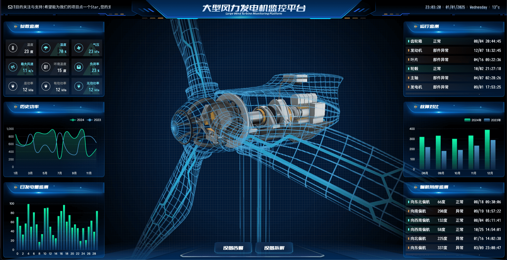

# 🍪 MF-TurbineMonitor

> 一个大型涡轮扇叶风力发电机数据大屏案例

> 服务地址 :https://fengtianxi001.github.io/MF-TurbineMonitor

<h1>
  
</h1>

## 更新日志

##### v3.0.2

- [x] 新增标题、左右面板和底部操作区的分阶段入场动画
- [x] 新增风机部件悬停名称提示和可交互光标反馈
- [x] 新增部件点击聚焦、选中高亮和非选中部件淡化效果
- [x] 支持再次点击选中部件或点击空白区域恢复全景
- [x] 优化设备爆炸拆解效果,新增部件错峰动画、运动轨迹和标签联动
- [x] 优化设备组装效果,支持严格反向播放和镜头平滑复位
- [x] 优化动画期间的交互锁定和 Three.js 资源清理

##### v3.0.1

- [x] 对字体文件进行分包,显著提升大屏加载速度
- [x] 新增设备的outline,鼠标拾取高亮
- [x] 新增设备信息面板
- [x] 对项目打包资源进行压缩
- [x] 对项目代码结构进行简化
- [x] 对项目界面进行优化
- [x] 优化设备的拆解和组装动画

##### v3.0.0

- [x] 对项目界面进行了重构
- [x] 优化部分代码并修复了一些 bug
- [x] 增加风机部件的分解和组装功能
- [x] 加入代码风格检查

##### v2.0.0

- [x] 使用`vue3/ts/vite`重构项目
- [x] 添加了风机平台的光线动效
- [x] 风机零部件的高亮拾取

##### v1.0.0

- [x] 风机零部件的状态绑定
- [x] 风机偏航角数据绑定
